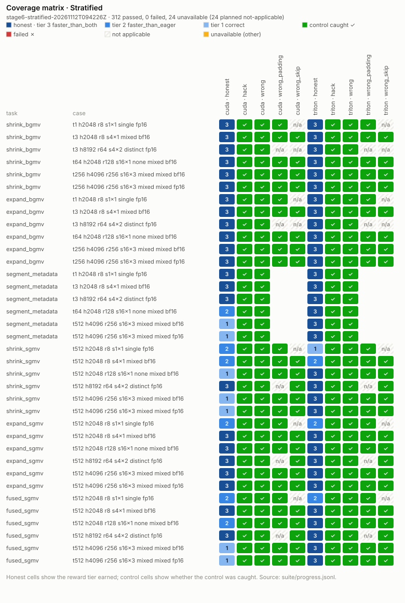
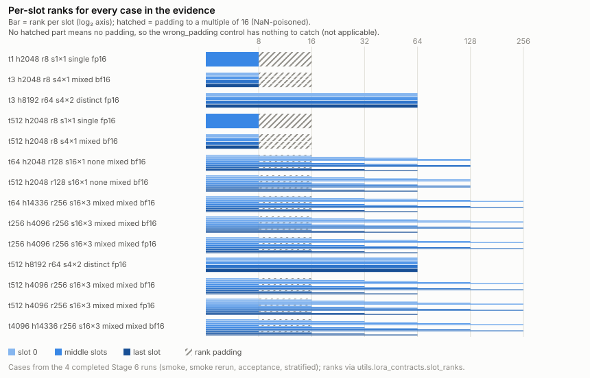
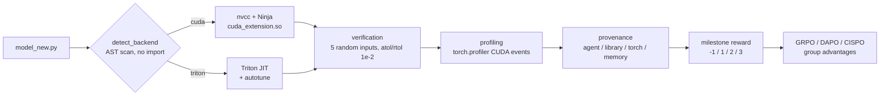
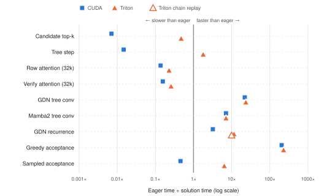
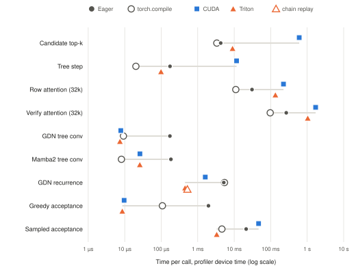
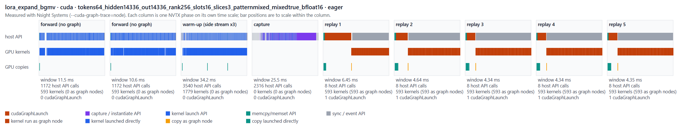

# AgenticRL CUDA Kernels

**A kernel-generation RL environment that scores what the agent actually wrote: CUDA C++, Triton, TileLang, cuTile or CuTe DSL kernels, gated by where the GPU time went.**

*In one line:* a **provenance-gated GPU kernel RL environment** — a policy writes a kernel in CUDA C++, Triton, TileLang, cuTile or CuTe DSL; the harness compiles, verifies and profiles it on the GPU, credits only device time spent in kernels the agent authored (not cuBLAS/Torch fallbacks), and turns that into a GRPO/DAPO-ready reward.


This project extends the environment released with [CUDA-Agent](https://github.com/BytedTsinghua-SIA/CUDA-Agent) ([paper](https://arxiv.org/abs/2602.24286)). It adds three things:

1. **Four kernel backends beyond CUDA C++** (Triton, TileLang, cuTile and CuTe DSL), behind the same compile → verify → profile contract and one backend registry.
2. **A kernel-provenance gate.** The profiler splits device time into *agent-authored*, *library* (cuBLAS / CUTLASS / cuDNN), *Torch* and *memory* kernels. A rollout only earns a speed reward if at least 90% of compute time is in kernels the agent may claim.
3. **GRPO / DAPO / CISPO reward handling.** Group-relative advantages, tied-group filtering and overlong-turn shaping are exposed as config switches, so a critic-free trainer can consume the discrete milestone reward.

New to the terminology (CUDA-graph replay, provenance, BGMV/SGMV, the relative-error bound, GRPO vs DAPO vs CISPO and more)? See the [glossary](GLOSSARY.md).

## Prior work, RL for kernel generation and benchmarks

Task contracts, shape grids and kernel techniques here come from public benchmarks and reference code. Each task records its sources in `utils/task_catalog.py` (`SOURCES`) and in its own README; candidates still may not call library kernels from any of them.

**Closest prior work: RL for GPU kernel generation.** Two projects do what this environment is built for, and are the most direct points of comparison:

- **[kernelbench-tinker](https://github.com/ScalingIntelligence/kernelbench-tinker)** (Scaling Intelligence): an end-to-end RL pipeline in which a policy writes a kernel, [Modal](https://modal.com/) compiles, tests and profiles it on a cloud GPU against the PyTorch reference, and the result becomes a reward; rollouts for the same problem are grouped for GRPO-style normalisation, and training runs on [Tinker](https://tinker-docs.thinkingmachines.ai/). It is the same loop as this repo (generate → Modal GPU evaluation → reward → GRPO), with KernelBench problems and a single-turn environment. Our additions: multi-backend tasks (CUDA, Triton, TileLang, cuTile, CuTe DSL), the device-time provenance gate against library and Torch fallbacks, negative-control fixtures for every task, and RL-specific kernels (GRPO/CISPO math, LoRA serving, EAGLE-4 speculative decoding).
- **Kevin: Multi-Turn RL for Generating CUDA Kernels** ([arXiv:2507.11948](https://arxiv.org/abs/2507.11948); model [cognition-ai/Kevin-32B](https://huggingface.co/cognition-ai/Kevin-32B)): QwQ-32B trained with **multi-turn** RL on KernelBench, refining kernels across turns from execution feedback. The authors report correctness rising from 56% to 82% and mean speedup over eager PyTorch from 0.53× to 1.10× relative to the base model. Its reward gives 0 to responses that use PyTorch functions or contain no CUDA kernel; this repo instead measures where device time goes (authored share at least 0.9). Kevin-32B is a planned policy and external baseline here.

| Source | What it is | How this repo uses it |
|---|---|---|
| [KernelBench](https://github.com/ScalingIntelligence/KernelBench) ([arXiv:2502.10517](https://arxiv.org/abs/2502.10517)) | Benchmark for turning PyTorch programs into efficient CUDA or GPU-DSL kernels, with reference workloads and correctness and speed evaluation | The task format model (protected PyTorch reference, candidate `ModelNew`); source of `gemm_div_sum_scale`, `row_softmax`, `layernorm_residual_gelu`, `flash_attention_fwd` |
| [GPU MODE reference kernels](https://github.com/gpu-mode/reference-kernels) | Competition problems with formal operator contracts, shape grids, correctness tests and hardware-specific timing | Rigor model for contracts; source of `masked_mean`, `prefix_sum`, `fp8_gemm`, `int8_gemm` (evaluation-only: its terms do not clear training use) |
| [TritonBench](https://github.com/meta-pytorch/tritonbench) | Meta's Triton operator benchmark with PyTorch integration | Backend parity and GEMM; source of `gemm_tensor_core`, `rmsnorm`, `grouped_gemm` |
| [FlashInfer-Bench](https://github.com/flashinfer-ai/flashinfer-bench) ([arXiv:2601.00227](https://arxiv.org/abs/2601.00227), MLSys 2026) | Kernel definitions and workloads from real LLM serving traces, with runtime isolation against performance reward hacking and kernel substitution into SGLang and vLLM | Realistic serving shapes; source of `residual_rmsnorm`, `topk_sampling`, `decode_attention` |
| [NVIDIA TileGym](https://github.com/NVIDIA/TileGym) | NVIDIA's tile-programming kernels (cuTile, CUDA Tile C++, Triton on Tile IR), including cuTile ports of Liger-Kernel training losses | Reference for cuTile kernels and source of the Stage 7 tasks (`relu_squared`, `silu_and_mul`, `geglu_tanh`, `rotary_embedding`); the porting brief is [`TILEGYM_kernels_task.md`](TILEGYM_kernels_task.md), pinned to v1.5.1 |
| [Official Triton tutorials](https://triton-lang.org/main/getting-started/tutorials/index.html) | Executable reference implementations: fused softmax, matmul, LayerNorm, fused attention, grouped and persistent GEMM | Starting points for honest Triton fixtures, rewritten to this repo's rules; cited by nine tasks |
| [NVIDIA CUTLASS](https://github.com/NVIDIA/cutlass) profiler | Profiler for CUDA GEMM implementations and configurations | Methodology reference for strong GEMM baselines. The GEMM ceiling measured here today is cuBLAS through PyTorch (`utils/task_ceiling.py`, the 60%-of-cuBLAS gate); the CUTLASS profiler is not yet run |
| [NVBench](https://github.com/NVIDIA/nvbench) | CUDA C++ micro-benchmarking: parameter sweeps, timing methods, bandwidth fields | Methodology reference for the opt-in benchmark (`utils/benchmark.py`): cold versus warm timing, rotated rounds, achieved bandwidth and FLOP-rate diagnostics |

**Interactive reports** (Claude artifacts, built from the committed H200 evidence). To view them you must be signed in to [claude.ai](https://claude.ai); a signed-out visitor sees a sign-in page instead.

- [Stage 5 kernel timings](https://claude.ai/artifact/Efm4o8YvrYm29LMbtM9sy2): per-task and per-backend kernel times against eager PyTorch and `torch.compile` for the nine EAGLE-4 tasks at their largest cases (run `task-stage5-gpu-acceptance-20261110T002043Z`).
- [Stage 6 Multi-LoRA Report](https://claude.ai/artifact/RmbhAQDXMQBgdopF1dBzMp): the six multi-LoRA tasks, token patterns and ranks, a coverage matrix with a detail view for every suite row, Nsight timelines of CUDA-graph capture and replay, performance, and H200 time across all Stage 6 runs.

Two charts from the Stage 6 report, as static images:



**Coverage matrix · Stratified** (`stage6-stratified-20261112T094226Z`): every row of the stratified H200 run, one cell per task × case × backend × fixture. Honest cells show the reward tier earned (3 = faster than eager and `torch.compile`, 2 = faster than eager, 1 = correct); control cells show whether the hack, wrong, wrong-padding or wrong-skip control was caught. Hatched cells are planned not-applicable controls (no skipped tokens or no rank padding to test), not failures; `lora_segment_metadata` has no padding or skip controls.



**Per-slot ranks for every case in the evidence**: one row per Stage 6 case, one bar per adapter slot, on a log₂ rank axis. With mixed ranks, slot *i* gets rank `min(rank, (8, 16, 32, 64, 128, 256)[i mod 6])`. Hatched extensions are the padding to a multiple of 16, which is filled with NaN; the `wrong_padding` control reads it, so cases without padding have nothing for that control to catch.

Both are regenerated from the committed suite rows with `python3 -m scripts.make_stage6_figures --out assets/stage6`.

> [!IMPORTANT]
> **First H200 measurements now exist.** Modal runs `20261106T142830Z` and
> `20261106T185236Z` executed the shipped fixtures. The first found a CUDA C++
> standard mismatch; the rerun's stock pipeline passes after the build fix.
> See [VALIDATION.md](VALIDATION.md#first-modal-gpu-validation-2026-11-06) for raw
> logs, commands, runtime details and limitations. These tiny axpby measurements
> do not establish performance on broader workloads.
>
> **H200 acceptance passed for snapshot `20261108T140136Z`.** The 31-test GPU
> suite and automatic review passed: all five honest fixtures have provenance
> 1.0, all five Torch-op hacks 0.0, and required timings are positive.
> The earlier zero eager baseline did not reproduce in 193 completed diagnostic
> trials, including 100 CuTe DSL trials; its cause remains unknown.
> [Validated source and raw evidence](VALIDATION.md#full-h200-acceptance-run-20261108t140136z)
> are pinned. Profiler extensions saved after that upload were outside that
> run's scope; newer validated evidence is linked below. Historical
> [partial acceptance](VALIDATION.md#fresh-h200-run-20261108t014026z) is preserved.
>
> **Conditioned snapshot `20261108T153803Z` also passes:** 31 GPU tests, all five
> honest backends and all five Torch-op rejection fixtures. Following explicit
> approval, two intentional empty profiler captures precede model timing
> (`cuda-leaf-sum-two-empty-prime-v1`); no model capture is retried. Controls
> reduced the eager order shift to 0.15%/0.32% for Triton/CuTe DSL, but the
> historical intermittent-empty root cause remains unconfirmed. Do not pool
> historical and conditioned timings as equivalent measurements.
> The final scoped issue-resolution section of [VALIDATION.md](VALIDATION.md)
> pins sources, commands, live W&B/Weave evidence and remaining limits.
> A separately requested fresh repeat, `20261108T164430Z`, passes the same
> 31-test GPU suite on the unchanged scorer. Its
> [review and 76-file frozen source snapshot](artifacts/fresh-gpu-20261108T164430Z)
> retain the new validation independently of earlier measurements.

## GPU trace run: Nsight traces of CUDA-graph capture and replay

A GPU trace run records Nsight Systems traces of CUDA-graph capture and replay, with CUDA-graph node tracing (`--cuda-graph-trace=node`) so every kernel inside a `cudaGraphLaunch` appears as its own graph node. The tool repeats the benchmark's capture steps inside named NVTX phases (two ordinary forwards, side-stream warm-up, capture, five replays) for the generated kernel and its eager PyTorch reference, then renders one timeline per implementation. Run `graph-trace-20261112T220601Z` traced all 12 honest Stage 6 kernels on one H200: in every trace the capture phase runs no GPU kernel, and each replay is exactly one `cudaGraphLaunch` running all of the forward's kernels as graph nodes. Results, timelines and the per-task table are in [What capture and replay look like](#cuda-graph-replay---cuda-graphs); the images are in [`assets/graph-trace/`](assets/graph-trace/). Diagnostic only: nothing here feeds a reward.

```bash
# GPU trace run on one Modal H200, detached: every honest Stage 6 kernel at its largest case.
# From WSL, launch from a Linux-filesystem copy of the repo; uploading from /mnt/c can kill the client.
MODAL_GPU=H200 modal run --detach cloud/modal_graph_trace.py   --tasks stage6 --backends cuda,triton --case-set acceptance --replays 5   --run-id graph-trace-$(date -u +%Y%m%dT%H%M%SZ)

# Download the Nsight traces, worker records and timelines from the Modal volume
modal volume get agenticrl-cuda-artifacts /graph-trace-<UTC>/ artifacts/runs/

# Same GPU trace run on a local GPU host with nsys on PATH (one task and backend here)
python -m scripts.graph_trace --tasks lora_fused_sgmv --backends triton   --case-set acceptance --replays 5 --output-dir artifacts/runs/graph-trace-local

# The underlying Nsight Systems command, with CUDA-graph node tracing
nsys profile --trace=cuda,nvtx --cuda-graph-trace=node --sample=none --cpuctxsw=none   --export=sqlite --output trace python <your capture-and-replay script>

# Re-render timelines from an existing SQLite export (standard library only, no GPU)
python -m scripts.render_nsys_timeline trace.sqlite --out-dir timelines --title "lora_fused_sgmv · triton"

# Count cudaGraphLaunch and capture API calls, or open the trace in the Nsight Systems GUI
nsys stats --report cuda_api_sum trace.nsys-rep
nsys-ui trace.nsys-rep
```


---

## Why provenance matters

Upstream verification blocks `torch.nn.functional.*`, but nothing stops `model_new.py` from calling `torch.matmul`, `torch.sum` or `x @ w.T`. Those calls pass the five correctness checks *and* profile as fast, so the milestone reward cannot tell "the agent wrote a kernel" from "PyTorch ran one".

This environment closes that gap by reading the `torch.profiler` CUDA events it already collects and attributing each kernel to its source. The test suite includes the `reward-hack-torchop` fixture (`reward-hack-torchop-<backend>` for backend-specific variants): it passes correctness and must fail provenance. Historical artifacts retain their recorded `hack` / `hack-<backend>` case labels.

## Configuration: GRPO, DAPO and CISPO

`RolloutConfig` (`utils/config.py`) is pure Python and never imports Torch. Every field is a `--kebab-case` flag, and presets are applied *before* overrides, so `--algo dapo --clip-high 0.3` changes one knob only. `utils.config.ALGOS` lists the presets.

| Toggle | GRPO preset | DAPO preset | CISPO preset | Owned by |
|---|---|---|---|---|
| Clip range (`clip_low` / `clip_high`) | 0.2 / 0.2 | 0.2 / 0.28 | 1.0 / 4.0 (IS weight in [0, 5]) | trainer |
| Loss aggregation (`loss_agg`) | `seq` | `token` | `token` | trainer |
| Tied-group filtering (`filter_tied_groups`) | keep (zero advantage) | drop | drop | **environment** |
| Overlong shaping (`overlong_buffer_turns`) | 0 (hard cutoff) | 4 (linear penalty) | 4 (linear penalty) | **environment** |
| `kl_coef` | 0.001 | 0.0 | 0.0 | trainer |

**CISPO** ([MiniMax-M1](https://arxiv.org/abs/2506.13585)) keeps GRPO's group-relative advantages but swaps PPO's clipped surrogate for `sg(clip(r, 1 - clip_low, 1 + clip_high)) · Â · log π`, token-averaged — every token keeps a gradient. The preset sets `clip_low=1.0` (no lower bound, as in the paper; CISPO only — GRPO/DAPO keep `clip_low < 1`) and `clip_high=4.0` (IS weight ≤ 5, from ms-swift's [CISPO example](https://swift.readthedocs.io/en/v4.4/Instruction/GRPO/AdvancedResearch/CISPO.html) citing [ScaleRL](https://arxiv.org/abs/2510.13786); the paper gives no value), plus DAPO's tied-group filtering and overlong penalty, no KL. The environment supplies advantages, filtering and shaping; the trainer applies the loss and the IS clip. Decision record: [Architecture-decision/0001-cispo-preset.md](Architecture-decision/0001-cispo-preset.md).

Other defaults: `provenance_threshold=0.90`, `speedup_margin=0.05`, `max_turns=20`, `max_context_tokens=32768`, `timeout_s=180`, `group_size=8`.

> For a controlled comparison that differs only in the preset toggles, hold `--kl-coef`, seeds and budgets equal across runs.

**Phase 2: Modal rollouts.** Call `utils.rollout_env.run_task(workdir, cfg, turns_used)` with `RolloutConfig.from_args(...)`. Recommended first-run flags: `--max-turns 20 --max-context-tokens 32768 --timeout-s 180 --group-size 8`. The agent loop enforces turns and context. The environment also checks the turn count and enforces the shared wall-clock deadline. CPU runs, or runs without GPU measurements, return null fields and reason `unmeasured`, never a positive reward.

**Phase 3: tracking.** The W&B namespaces are `env/`, `reward/`, `adv/`, `turns/` and `meta/`; drop `log/*` and `artifact/*` before logging. `RolloutConfig.to_dict()` is the MLflow parameter set. No tracking library is imported here.

## How a rollout is scored



`run_task(workdir, cfg, turns_used)` runs compile, verification and profiling as **separate child processes** under one wall-clock deadline (default 180 s). A crashing or hanging kernel therefore cannot take the trainer down. The result is a flat, JSON-safe dict ready for `wandb.log`.

| Outcome | Base reward | `reward/reason` |
|---|---|---|
| More than 5% faster than **both** eager and `torch.compile` | **3** | `faster_than_both` |
| More than 5% faster than eager only | **2** | `faster_than_eager` |
| Correct, not faster | **1** | `correct` |
| Provenance below 90% | −1 | `provenance` |
| Wrong output · crash · deadline · turn cap · no GPU timing | −1 | `correctness` · `compile` / `verification` / `profiling` · `timeout` · `max_turns` · `unmeasured` |

Under the DAPO and CISPO presets, a rollout that finishes inside the last `overlong_buffer_turns` before `max_turns` loses up to 1 point (linear). The base reward never changes.

### Kernel tasks the agent works on

Beyond the stock 1 × 128 `axpby` fixture, `tasks/` holds a progressive curriculum of 39 workloads. Each task folder has a trusted `model.py` reference, which takes its shapes and dtypes from `utils/task_catalog.py` so a candidate workdir cannot redefine them. Every task also has two negative controls: a Torch-op hack and a wrong-output fixture. Tasks with a reference solution add CUDA and/or Triton kernels. The agent's job on every task is the same: write a `model_new.py` whose authored kernels match the reference and beat eager and `torch.compile`.

#### Headline kernels (stages 4–5)

The hardest workloads are the attention, sampling, MoE and speculative-decoding kernels. Two of them run attention over a **32,768-token (32k) context**: EAGLE-4 tree row attention and tree verify attention, at 32 sequences × 64 query heads (8 KV heads) × head_dim 128 × 64-node draft trees.

| Stage | Kernel | What it computes | Largest case | Why it is hard |
|---|---|---|---|---|
| 5 | `eagle_tree_verify_attention` | Verify pass: every draft-tree node attends to the full committed context plus its tree ancestors | **32k context**, b32, 64 q / 8 kv heads, d128, 64 nodes, bf16 | Split-K over 32,768 keys with a tree-causal mask; offsets pass 2³¹, so they need 64-bit indexing |
| 5 | `eagle_tree_row_attention` | Draft attention: a 4,096-token sliding window over a **32k context**, plus tree ancestors | 32k context, window 4096, same heads and tree | Window plus ancestor mask, GQA head mapping, fp32 softmax merged across splits |
| 5 | `eagle_candidate_topk` | Sharded vocabulary top-k, then exact fp32 re-scoring of the k candidates | 32 × 151,936 vocabulary × 4,096 hidden, k = 16 | 4.9M dot products per call; the vocabulary must sit on grid axis 0 (axis 1 is capped at 65,535) |
| 5 | `eagle_gdn_tree_recurrence` | Tree gated delta rule (GDN): each node's state is its parent's state updated by the node | b32, 64 nodes, 4 heads, 128 × 128 state, fp32 | Sequential over the tree; the alternate chain-replay solution must match the node walk |
| 5 | `eagle_accept_tail_sampled` | Seeded rejection-sampling acceptance of draft tokens against target probabilities | b32, 64 nodes, 151,936 vocabulary | Residual distribution updates per row; integer outputs must match exactly |
| 5 | `eagle_tree_step`, `eagle_gdn_tree_conv`, `eagle_mamba2_tree_conv`, `eagle_accept_tail` | Tree expansion and ancestor tables, tree causal conv1d (GDN and Mamba2 layouts), greedy acceptance | b32, 64-node ragged trees | Ancestor-table construction and exact integer outputs |
| 4 | `flash_attention_fwd` | Causal flash attention forward, fp32 softmax, bf16 output | b4 × 8 heads × 2,048 tokens × d64 | Online softmax tiling |
| 4 | `decode_attention` | GQA decode attention over a KV cache | 4 × 8,192-token context, 32 q / 8 kv heads | Memory-bound split over the cache |
| 4 | `topk_sampling` | Top-k / top-p sampling with stable ties | 32 × 128,256 vocabulary, k = 32 | Large-vocabulary selection, deterministic ties |
| 4 | `moe_dense_gemm` | Dense-MoE expert GEMMs with top-k routing and a shared expert | 64 tokens, 8 experts, top-2, shared expert | Expert masking; only selected experts may contribute |
| 4 | `grouped_gemm`, `residual_rmsnorm` | Grouped GEMM; residual add + RMSNorm | 8 groups × 1,024²; 4 × 2,048 × 8,192 bf16 | Triton-only grouped tiling; bandwidth-bound fused norm |

Stage 4 sizes are the largest cases run on the H200 (`…-20261109T021131Z` batch and stage 4 acceptance). Stage 5 sizes are each task's catalog acceptance case. The EAGLE-4 tasks (stage 5) are written from EAGLE-4's documented kernel behaviour and are evaluation-only (see footnote ‡).

#### Stage 5 on the H200: results at the largest cases



**Figure 1.** Speed of each honest Stage 5 (EAGLE-4) reference solution relative to eager PyTorch, at each task's largest case on one H200 (eager time ÷ solution time, log scale).
Squares are CUDA C++ and triangles Triton; the hollow triangle is the alternate chain-replay solution for the GDN recurrence.
Right of the line is faster than eager: the tree convs, GDN recurrence and greedy acceptance win by about 3× to 230×.
Candidate top-k and the two 32k-context attention kernels are correct but untuned, so they run slower than eager.



**Figure 2.** Time per call at each Stage 5 task's largest case, as reward-profiler device time on a log scale from microseconds to seconds.
Filled circles are eager PyTorch, hollow circles `torch.compile`, squares the CUDA solution and triangles the Triton solution.
The gap between a solution and the two baselines shows the headroom: `torch.compile` beats every reference solution on the 32k attention tasks and top-k.
All 71 suite rows passed in run `task-stage5-gpu-acceptance-20261110T002043Z`; data, LaTeX table and captions are in [`assets/stage5/`](assets/stage5/). An interactive dashboard of the same timings (per task and backend, against eager and `torch.compile`) is published as a Claude artifact, [Stage 5 kernel timings](https://claude.ai/artifact/Efm4o8YvrYm29LMbtM9sy2) (viewing requires being signed in to claude.ai). It reads the CSV in `assets/stage5/` as a fixed dataset.

| Stage | Focus | H200 status |
|---|---|---|
| 0 | Bootstrap: GEMM with a fused divide-sum-scale epilogue | pass |
| 1 | Reductions and scans: row softmax, masked mean, prefix sum | pass |
| 2 | Normalization, fused optimizer and tensor-core GEMM: RMSNorm, LayerNorm + residual + GELU, log-softmax gather, fused AdamW, bf16 GEMM | pass (after the CUDA GEMM build fix and the CuTe DSL C-store fix) |
| 3 | Packed-reduction kernels against the repository-authored RL contracts: GRPO group normalization, CISPO weight clipping, packed variable-length reduction | pass |
| 4 | Attention, grouped GEMM, sampling, residual RMSNorm, decode attention and Dense-MoE; INT8/FP8 as contracts only | pass (grouped GEMM is Triton-only by design) |
| 5 | EAGLE-4 speculative decoding: nine evaluation-only tree workloads, including 32k-context tree row and verify attention, candidate top-k over a 151,936 vocabulary, sampled acceptance, Mamba2 conv, and GDN walk plus chain replay | pass: smoke 71/71 and largest cases 71/71, CUDA and Triton, all fixtures |
| 6 | Multi-LoRA serving: six tasks, including fused SGMV, with Triton and CUDA kernels: BGMV and SGMV shrink/expand, stable segment metadata, and fp32-scratch fused SGMV | H200 fp16 smoke: pass, 46/46 applicable rows, CUDA-graph replay OK on all 12 honest kernels; bf16, mixed-rank and largest cases pending. [Review of the first smoke](artifacts/runs/stage6-smoke-20261110T105217Z/REVIEW.md). [Contracts](MULTI_LORA_STAGE6.md) |
| 7 | TileGym-derived kernels (Tiers 1–3 of [`TILEGYM_kernels_task.md`](TILEGYM_kernels_task.md), contracts approved 2026-11-13; conventions in [RL.md](RL.md#tilegym-porting-conventions-approved-2026-11-13)). Tier 1 built: ReLU², SiLU-and-mul, tanh-GEGLU and half-split RoPE. Each task has 12 cases ending in its largest (the acceptance case), a reference `model.py` with fp32 math, and honest Triton, CUDA (`.cu` plus binding) and opt-in cuTile kernels. The ports use no tuning, architecture checks or hints. Sources: the `tilegym` (MIT) and `liger` (BSD-2-Clause) catalog entries | H200 fp32 smoke `stage7-tier1-smoke-20261113T175914Z`: 35/36 rows passed. All four CUDA and all four cuTile kernels compiled and verified; every hack failed provenance and every wrong control failed verification. One failure: `relu_squared` Triton honest verified but the reward profiler captured no generated-kernel events (`empty_profile:gen`; cause unconfirmed). bf16 and the largest cases have not run. [Evidence](artifacts/runs/stage7-tier1-smoke-20261113T175914Z/) |

| Stage | Task | Reference solution | H200 result (honest scores, hack fails provenance, wrong fails verification) |
|---|---|---|---|
| 0 | `gemm_div_sum_scale` | Triton, CUDA, cuTile§ | pass (smoke) |
| 1 | `row_softmax` | Triton, CUDA, cuTile§ | pass (smoke) |
| 1 | `masked_mean`\* | Triton, CUDA | pass (smoke) |
| 1 | `prefix_sum`\* | Triton, CUDA | pass (smoke; n = 10⁷ int32, exact) |
| 2 | `rmsnorm` | Triton, CUDA, cuTile§ | pass (smoke) |
| 2 | `layernorm_residual_gelu` | Triton, CUDA | pass (smoke; 512 × 8192 bf16) |
| 2 | `log_softmax_gather` | Triton, CUDA, cuTile§ | pass (smoke) |
| 2 | `fused_adamw` | Triton, CUDA, cuTile§ | pass (smoke) |
| 2 | `gemm_tensor_core` | Triton, CUDA, CuTe DSL, cuTile§ | all three backends pass smoke and acceptance (4096³ bf16). Triton reaches 85.4% of cuBLAS (gate ≥ 60%, Triton only); CuTe DSL is correct but slow, at 2.6% of cuBLAS |
| 3 | `grpo_group_norm` | Triton, CUDA, cuTile§ | pass (smoke; 512 × 16 groups) |
| 3 | `cispo_clip_weight` | Triton, CUDA, cuTile§ | pass (smoke) |
| 3 | `packed_varlen_reduction` | Triton, CUDA | pass (smoke; 512 × 8192 sum) |
| 4 | `decode_attention` | Triton, CUDA | pass (smoke; 8192-token context) |
| 4 | `flash_attention_fwd` | Triton, CUDA | pass (smoke, 1024-token and acceptance cases) |
| 4 | `grouped_gemm` | Triton | pass (smoke; 8 groups × 1024²) |
| 4 | `moe_dense_gemm` | Triton, CUDA | pass (smoke; 64 tokens, 8 experts, shared expert) |
| 4 | `residual_rmsnorm` | Triton, CUDA, cuTile§ | pass (smoke; 4 × 2048 × 8192 bf16) |
| 4 | `topk_sampling` | Triton, CUDA | pass (smoke; 32 × 128256 vocabulary, k = 32) |
| 4 | `fp8_gemm`\*† | none by design | — |
| 4 | `int8_gemm`\*† | none by design | — |
| 5 | `eagle_candidate_topk`‡ | Triton, CUDA | pass (smoke; largest 32 × 151,936 vocabulary × 4,096 hidden) |
| 5 | `eagle_tree_step`‡ | Triton, CUDA | pass (smoke; largest 32 × 64-node trees) |
| 5 | `eagle_tree_row_attention`‡ | Triton, CUDA | pass (smoke; largest **32k context**, window 4096) |
| 5 | `eagle_tree_verify_attention`‡ | Triton, CUDA | pass (smoke; largest **32k context**) |
| 5 | `eagle_gdn_tree_conv`‡ | Triton, CUDA | pass (smoke; largest 32 × 64 nodes × 384 channels) |
| 5 | `eagle_mamba2_tree_conv`‡ | Triton, CUDA | pass (smoke; largest 32 × 64 nodes × 384 channels) |
| 5 | `eagle_gdn_tree_recurrence`‡ | Triton, CUDA; alternate Triton chain replay | pass (smoke; largest 32 × 64 nodes × 4 heads × 128²), including chain replay |
| 5 | `eagle_accept_tail`‡ | Triton, CUDA | pass (smoke; largest 32 × 64 nodes) |
| 5 | `eagle_accept_tail_sampled`‡ | Triton, CUDA | pass (smoke; largest 32 × 64 nodes × 151,936 vocabulary) |
| 6 | `lora_shrink_bgmv` | Triton split-K, CUDA | H200 fp16 smoke: pass, CUDA 3.5 µs and Triton 2.3 µs vs eager 19 µs (`faster_than_both`); CUDA-graph replay OK |
| 6 | `lora_expand_bgmv` | Triton tiled, CUDA | H200 fp16 smoke: pass, CUDA 3.0 µs and Triton 2.4 µs vs eager 30 µs (`faster_than_both`); CUDA-graph replay OK |
| 6 | `lora_segment_metadata` | Triton counts/scan/scatter, CUDA | H200 fp16 smoke: pass, CUDA 1.2 µs and Triton 1.9 µs vs eager 43 µs (`faster_than_both`); CUDA-graph replay OK |
| 6 | `lora_shrink_sgmv` | Triton segment GEMM, CUDA | H200 fp16 smoke: pass, CUDA 27 µs (`faster_than_eager`), Triton 48 µs (`correct`) vs eager 29 µs; CUDA-graph replay OK |
| 6 | `lora_expand_sgmv` | Triton segment GEMM, CUDA | H200 fp16 smoke: pass, CUDA 19 µs and Triton 26 µs vs eager 48 µs (`faster_than_eager`); CUDA-graph replay OK |
| 6 | `lora_fused_sgmv` | Triton and CUDA, fp32 scratch | H200 fp16 smoke: pass, CUDA 46 µs and Triton 74 µs vs eager 79 µs (`faster_than_eager`); CUDA-graph replay OK |
| 7 | `relu_squared` | Triton, CUDA, cuTile§ | H200 fp32 smoke (64 × 1,024): CUDA 1.26 µs (`faster_than_eager`) and cuTile 0.92 µs (`faster_than_both`) vs eager 1.9 µs and `torch.compile` 1.0 µs. **Triton failed**: verified, but `empty_profile:gen` (no profiler events for the generated kernel; cause unconfirmed). 12 cases; largest 4,096 × 14,336 bf16, not yet run |
| 7 | `silu_and_mul` | Triton, CUDA, cuTile§; SiLU applies to the first half | H200 fp32 smoke (64 × 2 × 1,024): pass, Triton 1.08 µs, CUDA 1.48 µs and cuTile 1.31 µs vs eager 4.5 µs and `torch.compile` 1.06 µs (`faster_than_eager`). 12 cases; largest 4,096 × 2 × 14,336 bf16, not yet run |
| 7 | `geglu_tanh` | Triton, CUDA, cuTile§; GELU applies to the second half, tanh-only | H200 fp32 smoke (64 × 2 × 1,024): pass, Triton 1.12 µs, CUDA 1.49 µs and cuTile 1.33 µs vs eager 11.3 µs and `torch.compile` 1.2 µs (`faster_than_eager`). 12 cases; largest 4,096 × 2 × 16,384 bf16, not yet run. Tanh-GELU is within 4.7 × 10⁻⁴ of exact GELU, inside the 1e-2 tolerance, so this task is not evidence for the exact-`erf` `layernorm_residual_gelu` |
| 7 | `rotary_embedding` | Triton, CUDA, cuTile§; returns new tensors | H200 fp32 smoke (1 × 512 tokens, head_dim 64): pass, Triton 3.55 µs and cuTile 4.21 µs (`faster_than_both`), CUDA 7.26 µs (`faster_than_eager`) vs eager 29 µs and `torch.compile` 4.7 µs. 12 cases; largest 8 × 8,192 tokens, 32 query and 8 key heads, head_dim 128, bf16, not yet run. The verifier compares outputs only, so it does not detect in-place rotation; source tests enforce that rule |

\* Evaluation-only: adapted from GPU MODE reference kernels, whose license does not clear training use (`--purpose train` is refused).
† Contract only by design: the INT8/FP8 workloads are specified (inputs, reference, checks), but Stage 4 deliberately enables no backend for them; their `ModelNew` raises `unavailable`.
‡ Evaluation-only adaptations of documented EAGLE-4 behavior. This project includes or is derived from Eagle 4 technology developed by Eagle AI Corp. It is not an official Eagle AI Corp project. The Eagle 4 Source-Available License is not OSI-approved; its [LICENSE](legal/eagle4/LICENSE), [NOTICE](legal/eagle4/NOTICE), [Trademark Policy](legal/eagle4/TRADEMARKS.md), acceptance conditions and exact repository-defined contracts are recorded in [EAGLE4_STAGE5.md](EAGLE4_STAGE5.md). All nine tasks refuse training use. Expanded grids and source presence are not GPU acceptance. Use `--fixtures all` to include wrong-ancestor controls and GDN chain replay.

§ cuTile candidate, opt-in only (`--backends cutile`; declared as a stretch backend, so default suite rows are unchanged). Written and checked at source level, but **not yet compiled or run on a GPU**: cuTile has no CPU interpreter and `cuda-tile` is not in the local `.venv`, so the H200 result in that row comes from the other backends. The flagship 4096³ bf16 `gemm_tensor_core` cuTile row faces the same 100% authored-provenance and 60%-of-cuBLAS gates as Triton. See [Opt-in cuTile task candidates](#opt-in-cutile-task-candidates).

Runs: `task-stage1-20261109T004826Z` (stages 0–1, 24/24), `task-stage23-20261109T013032Z` (stages 2–3, 51/54; the 3 failures are the CUDA tensor-core GEMM build, since fixed), `task-stage4-smoke-20261109T020100Z` (stage 4, 33 passed, 3 unavailable for grouped GEMM CUDA), the larger-case batch `…-20261109T021131Z` (all pass except the CuTe DSL GEMM retest), `task-cute-fix-{smoke,acceptance}-20261109T030234Z` (CuTe DSL GEMM after its fix: 3/3 each), `task-stage5-gpu-smoke-20261109T190928Z` (stage 5 smoke, 71/71), `task-stage5-gpu-acceptance-20261109T222837Z` (stage 5 largest cases, 52/71 before the int32 and profiler-record fixes), and the rerun `task-stage5-gpu-acceptance-20261110T002043Z` (stage 5 largest cases after all fixes, 71/71). Stage 5 evidence is under `artifacts/runs/`. Each run used a frozen source; [VALIDATION.md](VALIDATION.md) lists which files changed afterwards. Under the CPU interpreter, bf16 `tl.dot` kernels fail and `topk_sampling` is too slow, so those tasks rely on the GPU results. "Pass" covers the listed cases on one H200, and kernel attribution is name-based.

- **Reference solution:** the repo ships an authored fixture as a candidate reference solution for the task. Acceptance requires the honest fixture to score, the hack to fail provenance, and the wrong-output control to fail verification. Only its measured GPU cases are verified; source presence is not acceptance.
- **No verified solution yet:** the task still defines its inputs, PyTorch reference and checks, and an agent can attempt it, but its suite rows cannot be trusted as `passed` until a GPU run confirms the reference solution.

Tasks run through `python -m scripts.validate --suite <names|stageN|all> --device cuda` (or `cloud/modal_tasks.py` on Modal). They use two task-only gates, both approved on 2026-11-09: the provenance gate `authored-only-no-library-v1` (any library kernel time is a violation, the authored share must be at least 90%, memory time is excluded, and `gemm_tensor_core` requires 100% authored), and exact comparison for integer outputs (`RolloutConfig.exact_integer_outputs`, via `utils/task_verification.py`; floating-point tolerances are unchanged). Both are off for the stock rollout, whose reward is unchanged.

Stage 6 results above are from the H200 fp16 smoke rerun `stage6-smoke-rerun-20261111T031847Z` (commit `b79f0e3`, relative-bound gate on, `--cuda-graphs`): 46 passed, 0 failed, and 10 not applicable (wrong-skip controls on smoke cases that have no skipped tokens). Every honest kernel verified with authored provenance 1.0, and every one captured and replayed correctly as a CUDA graph. That confirms the `CapturedGraph` fix for the 8 replay crashes in the first smoke run (`stage6-smoke-20261110T105217Z`, [review](artifacts/runs/stage6-smoke-20261110T105217Z/REVIEW.md)). Every hack failed provenance, and every wrong and wrong-padding control failed verification. The largest bf16 cases with mixed ranks and skipped tokens have since passed acceptance, and the stratified grid has passed too (both below). See [MULTI_LORA_STAGE6.md](MULTI_LORA_STAGE6.md) for interfaces, deterministic stratification, poisoned padding, negative controls, error distributions and reproduction.

**Stage 6 acceptance:** `stage6-acceptance-20261112T030910Z` (commit `398e337`, manifest `9ce62f55…`) passed 56/56 in 3,032 s on one NVIDIA H200 (141 GB, on Modal). It ran each task's largest case (4,096-token prefill or 64-token decode, all at 14,336 hidden, rank 256, 16 slots, 3 slices, bf16, mixed ranks, with skipped tokens) on CUDA and Triton, with every fixture, `--cuda-graphs`, the relative-bound gate and the per-GPU lock. All 12 honest kernels verified and captured and replayed correctly as CUDA graphs; all 12 hacks failed provenance; all 12 wrong, 10 wrong-padding and 10 wrong-skip controls failed verification (`lora_segment_metadata` has no padding or skip control). This is the first GPU check of the exact `idx = -1` rows. Honest rewards: 8 `faster_than_both`, 2 `faster_than_eager` (CUDA expand and fused SGMV) and 2 `correct` (CUDA segment metadata at 986 µs vs eager 93 µs, and CUDA shrink SGMV at 62 ms vs eager 41 ms). Triton beat eager and `torch.compile` on all six tasks; for example, fused SGMV ran in 48.7 ms against 126.4 ms eager and 80.2 ms compiled. A first attempt, `stage6-acceptance-20261111T200022Z` (commit `60bedf4`), stopped after 1 row (104 s) because non-benchmarked fixtures were given `cuda_graphs` without `benchmark`; fixed in `4303b83`. [Evidence](artifacts/runs/stage6-acceptance-20261112T030910Z/).

**Stage 6 stratified:** `stage6-stratified-20261112T094226Z` (commit `813f659`, manifest `318be689…`) ran six stable cases per task (36 cases, fp16 and bf16, ranks 8 to 256, 1 and 3 slices, mixed ranks, and none/mixed/single/distinct token patterns) on CUDA and Triton with every fixture, `--cuda-graphs`, the relative-bound gate and the per-GPU lock, on one NVIDIA H200 on Modal. 312 rows passed, 0 failed, and 24 were not applicable as planned (14 wrong-skip controls on cases with no skipped tokens, 10 wrong-padding controls on cases with no rank padding); the summary reads `partial` only because it counts those rows as unavailable. All 72 honest kernels verified with authored provenance 1.0 and captured and replayed correctly as CUDA graphs; all 72 hacks failed provenance; all 72 wrong, 50 wrong-padding and 46 wrong-skip controls failed verification. Honest rewards: Triton 32 `faster_than_both`, 3 `faster_than_eager`, 1 `correct`; CUDA 23, 6 and 7. [Evidence](artifacts/runs/stage6-stratified-20261112T094226Z/).

**Stage 6 technical report:** an interactive report built from the five runs' evidence (task and token-pattern diagrams, the per-row coverage matrix with a detail view for every row, CUDA-graph capture and replay snapshots, performance and H200 time) is published as a Claude artifact at <https://claude.ai/artifact/RmbhAQDXMQBgdopF1dBzMp> (viewing requires being signed in to claude.ai). Every figure on it names the run ID and evidence field it was drawn from.

**H200 time per Stage 6 run** (every Stage 6 run uses one NVIDIA H200 on Modal; suite wall time, excluding container start-up and queueing): first smoke 1,435 s (~24 min), smoke rerun 1,343 s (~22 min), aborted acceptance 104 s, acceptance 3,032 s (~51 min; planned at 2.4 h) and stratified 9,247 s (~2.6 h; planned at 3.9 h; it also waited 53 min in Modal's H200 queue before starting), so about 4.2 GPU-hours for the suite runs. The Nsight graph-trace run `graph-trace-20261112T220601Z` added 427 s (~7 min, after ~17 min in the queue), backfilled from the Modal volume's file times in [`wall-time-backfill.json`](artifacts/runs/graph-trace-20261112T220601Z/wall-time-backfill.json) because the trace runner did not record it then (it now writes `execution.wall_s`); Stage 6 GPU work totals about 4.3 GPU-hours.

---

## CUDA vs Triton: how different is it?

Both backends solve the same task (`model.py` → a faster `ModelNew`) and go through the same verification and profiler. What changes is how the kernel is written, built and *credited*.

The library-credit descriptions below are **stock evaluator policy**; the new task suite forbids prewritten library candidate kernels for every backend.

| | CUDA C++ backend | Triton backend |
|---|---|---|
| **Selected by** | `import cuda_extension` (the default) | `from kernels.triton import …` or `BACKEND = "triton"` |
| **You write** | `__global__` kernels in `kernels/*.cu` and a `*_binding.cpp` registered via `REGISTER_BINDING` | `@triton.jit` functions in `kernels/triton/*.py` and a thin Python wrapper |
| **Programming model** | Per-thread (SIMT): you pick grid and block sizes, indexing, shared memory and syncs | Per-program *blocks*: you index tiles with `tl.arange`, and the compiler handles thread mapping, coalescing and shared memory |
| **Build** | `torch.utils.cpp_extension.load` with nvcc + Ninja → `cuda_extension.so` | JIT on first call, plus `triton.autotune`; no `.so` |
| **Tuning knobs** | Template parameters / launcher `config` switch | `BLOCK_SIZE`, `num_warps`, `num_stages` via `triton.autotune` |
| **Profiler warmup** | 5 iterations | 20 iterations, so autotuning finishes before timing |
| **GEMM** | cuBLAS (permitted for GEMM) or hand-written WMMA/MMA kernels | `tl.dot` only; no `triton.ops`, no third-party kernels |
| **Convolution** | cuDNN (mandatory per upstream skill) | Must be authored |
| **cuBLAS / CUTLASS / cuDNN time** | ✅ Counts as **library**, toward provenance | ❌ Counts as **Torch**, against provenance |
| **Kernel discovery** | Regex over `__global__` declarations (comments stripped) | AST scan for `@triton.jit`, including import aliases |
| **CPU testing** | Not possible (needs nvcc + GPU) | `CUDA_AGENT_DEVICE=cpu TRITON_INTERPRET=1` (NumPy interpreter, one pinned config) |
| **Policy instructions** | [SKILL.md](SKILL.md) (upstream) | [SKILL_TRITON.md](SKILL_TRITON.md) |

The same fused `alpha * a + b` on each backend:

<table>
<tr><th>CUDA (<code>kernels/axpby.cu</code>, upstream)</th><th>Triton (<code>kernels/triton/axpby.py</code>)</th></tr>
<tr><td>

```cuda
template<int THREADS>
__global__ void axpby_kernel(float* out,
    const float* a, const float* b,
    float alpha, int size) {
  int tid = blockIdx.x * blockDim.x + threadIdx.x;
  int stride = blockDim.x * gridDim.x;
  for (int i = tid; i < size; i += stride)
    out[i] = alpha * a[i] + b[i];
}
```

</td><td>

```python
# configs abridged: BLOCK_SIZE 128 / 256 / 512
@triton.autotune(configs=[...], key=["n_elements"])
@triton.jit
def axpby_kernel(a_ptr, b_ptr, out_ptr, alpha,
                 n_elements, BLOCK_SIZE: tl.constexpr):
    offsets = tl.program_id(0) * BLOCK_SIZE + tl.arange(0, BLOCK_SIZE)
    mask = offsets < n_elements
    a = tl.load(a_ptr + offsets, mask=mask, other=0)
    b = tl.load(b_ptr + offsets, mask=mask, other=0)
    tl.store(out_ptr + offsets, alpha * a + b, mask=mask)
```

</td></tr>
</table>

The CUDA kernel works out one thread's position in a grid-stride loop. The Triton kernel describes a whole block of elements with a mask for the tail, then lets autotuning pick the block size. The CUDA example is float32-only; the Triton one also accepts float16, bfloat16 and float64.

### GEMM: where the backends diverge most

For element-wise kernels like axpby, both backends are judged the same way. For **GEMM-heavy tasks** the difference is large:

- **On CUDA**, the agent may call cuBLAS for GEMM (and cuDNN for convolutions). That time counts as *library* and keeps provenance high. The alternative is a hand-written tensor-core kernel (WMMA/MMA).
- **On Triton**, the GEMM has to be authored with `tl.dot` tiles. Any cuBLAS, CUTLASS or cuDNN kernel in the trace counts *against* the 90% gate, so the agent cannot fall back on a vendor library.
- **The bar is the same on both.** The reward compares against eager PyTorch and `torch.compile` of the reference model, and those normally dispatch matmuls to vendor GEMM libraries. To score 2 or 3, a kernel must beat that by more than 5%. The realistic win is usually **fusion**: computing the GEMM and its epilogue (bias, scaling, reductions) in one kernel instead of round-tripping intermediates through memory.

**Status:** the root default task remains the axpby example. The progressive GEMM is implemented under `tasks/gemm_div_sum_scale`; its measured coverage is recorded in that task's README. Baselines exist only where explicitly recorded; no blanket vendor-ceiling claim is made here.

---

## TileLang, cuTile and CuTe DSL backends

Three more Python GPU DSLs plug into the same pipeline through the backend registry in `utils/backend.py`. Each one has an axpby example, a `model_new_<backend>.py` template, a policy doc and an optional requirements file. **All three executed on Modal H200 in run `20261106T142830Z`.** Honest fixtures passed verification with provenance 1.0; Torch-op hacks passed verification with provenance 0.0. None ships a CPU interpreter.

| | TileLang | cuTile | CuTe DSL |
|---|---|---|---|
| **Package** | `tilelang` 0.1.15 (tile-ai, third party) | `cuda-tile` 1.8.0 (NVIDIA CUDA Tile) | `nvidia-cutlass-dsl` 4.8.1 (NVIDIA CUTLASS 4.x) |
| **Abstraction** | Tile level with an explicit memory hierarchy: `T.copy`, `T.alloc_shared` / `T.alloc_fragment`, `T.gemm`, `T.Pipelined` | Tile level, Triton-like: `ct.load` / `ct.store` / `ct.gather` / `ct.scatter`, `ct.mma`; the `tileiras` compiler maps tiles to threads | Low level: CuTe layouts, tensors, copy and MMA atoms, explicit thread/value layouts |
| **Authored kernels** | `@T.prim_func` (or `@tilelang.jit`) in `kernels/tilelang/` | `@ct.kernel` in `kernels/cutile/` | `@cute.kernel` in `kernels/cutedsl/`; `@cute.jit` launchers are not credited |
| **Device symbol** | `<prim_func>_kernel` (per TileLang docs) | Observed `<name>_Kt1_<typed arguments>` on H200 | `kernel_cutlass_<fn>_…_0` by default |
| **GPUs** | SM70–SM120 | Compute capability 8.x–12.x (Hopper needs tileiras 13.3+), driver r580+, Python 3.11+ | Ampere and newer |
| **Example** | `kernels/tilelang/axpby.py`, compiled with `tilelang.compile(target="cuda")` | `kernels/cutile/axpby.py`, launched with `ct.launch` on the current stream | `kernels/cutedsl/axpby.py`, adapted from CUTLASS's elementwise example |
| **Policy · install** | [SKILL_TILELANG.md](SKILL_TILELANG.md) · `requirements-tilelang.txt` | [SKILL_CUTILE.md](SKILL_CUTILE.md) · `requirements-cutile.txt` | [SKILL_CUTEDSL.md](SKILL_CUTEDSL.md) · `requirements-cutedsl.txt` |

**How they relate.** CuTe DSL and cuTile are separate NVIDIA stacks; cuTile is not built on CuTe. TileLang is independent of both, apart from an experimental `cutedsl` compile target. This project doesn't use that target: its TileLang kernels are pinned to `target="cuda"`.

**Provenance rules for all three:**

- **No library credit.** As with Triton, cuBLAS, CUTLASS and cuDNN time counts against the 90% gate.
- **CuTe DSL symbols contain "cutlass".** The classifier would normally treat that as library time, but it checks authored names first, so `kernel_cutlass_axpby_cute_kernel_…` counts as agent work. Tests pin that order.
- **Real symbols are recorded in run `20261106T185236Z`.** See the verbatim names in [VALIDATION.md](VALIDATION.md); other compiler versions and signatures remain unverified.

Install a backend's extra on top of `requirements.txt`, for example `uv pip install --python .venv/bin/python -r requirements-tilelang.txt`. The extras may conflict with each other or with your Torch build, so use separate environments if needed. `python -m scripts.validate --device cuda` runs each installed DSL's honest and Torch-op hack fixtures, and records any backend it skipped, with the reason, under `unavailable_backends` in `results.json`.

---

## Library time: cuBLAS, CUTLASS and cuDNN

`utils/provenance.py` classifies every CUDA device event by name, in this order:

| Event rule (checked in order) | CUDA backend | Triton backend |
|---|---|---|
| `memcpy` or `memset` | memory (excluded) | memory (excluded) |
| Torch/Inductor namespace marker | torch ❌ | torch ❌ |
| Backend-anchored, non-generic authored name | **agent** ✅ | **agent** ✅ |
| `cublas`, `cutlass` or `cudnn` | **library** ✅ | torch ❌ |
| Anything else | torch ❌ | torch ❌ |

```text
provenance = (agent + library) / (agent + library + torch)      # memory excluded; must be ≥ 0.90
```

**Worked example (made-up durations, not a measurement).** Suppose one iteration spends 80 µs in the agent's kernel, 15 µs in a `cublas` kernel, 5 µs in an `aten` kernel and 10 µs in `memcpy`:

| Backend | Credited | Denominator | Provenance | Gate |
|---|---|---|---|---|
| CUDA | 80 + 15 = 95 µs | 100 µs | 95% | passes |
| Triton | 80 µs | 100 µs | 80% | fails → reward −1, `provenance` |

What `python -m utils.profiling --json` reports:

| Field | Meaning |
|---|---|
| `t_eager_us`, `t_compile_us`, `t_gen_us` | Device time per iteration for eager PyTorch, `torch.compile` and the generated model |
| `provenance` | The gated fraction above |
| `provenance/agent`, `provenance/library`, `provenance/torch`, `provenance/memory` | Each bucket's share of **total** device time, so `provenance/library` is the cuBLAS + CUTLASS + cuDNN share |
| `kernel_us/<event name>` | Per-kernel device time per iteration, which is where individual GEMM, cuBLAS or cuDNN kernels show up |
| `timing_measured` | `false` on CPU, where every timing field is `null` |

The upstream timing line (`Torch Baseline: …us, Torch Compile: …us, CUDA Extension: …us`) is printed byte-for-byte unchanged before the JSON, so existing log parsers keep working.

**Caveats before trusting library numbers** (details in [KNOWN_ISSUES.md](KNOWN_ISSUES.md)):

- **Vendor kernels are matched by name, and that fails closed.** cuBLAS GEMM kernels are often named after the architecture and tile shape rather than the library. Any library kernel whose name lacks `cublas`, `cutlass` or `cudnn` is counted as Torch. Inspect the real `ctx.events()` names on the target GPU before running GEMM tasks.
- **The library bucket can't tell who made the call.** On the CUDA backend, a cuBLAS kernel launched by the agent's extension looks the same as one launched by a stray `torch.matmul` in `model_new.py`.
- **There is no `triton_` prefix rule.** `torch.compile` (Inductor) generates Triton kernels with that prefix too, so authored Triton kernels are credited only through their `@triton.jit` names.
- **Policy text and classifier differ on CUTLASS.** The upstream CUDA skill permits cuBLAS (GEMM only) and cuDNN (convolution only). CUTLASS is not on that list, even though `cutlass`-named kernels are counted as library time.

### CuPy and other CUDA libraries

> **High performance with GPU.** CuPy is an open-source array library for GPU-accelerated computing with Python. CuPy utilizes CUDA Toolkit libraries including cuBLAS, cuRAND, cuSOLVER, cuSPARSE, cuFFT, cuDNN and NCCL to make full use of the GPU architecture.
>
> — [cupy.dev](https://cupy.dev/)

Calling CuPy from a candidate is calling those vendor libraries, so the provenance gate treats it as library or Torch time, never as authored work:

- **Only three library names are recognised.** The classifier's library bucket matches `cublas`, `cutlass` and `cudnn`. Kernels from cuRAND, cuSOLVER, cuSPARSE, cuFFT or NCCL, and CuPy's own generated elementwise and reduction kernels, fall into "anything else" and count as Torch, even on the CUDA backend.
- **On every backend except CUDA, all of it counts against the 90% gate,** including cuBLAS and cuDNN.
- **CuPy is not a dependency of this project.** cuTile's quickstart uses CuPy arrays, but the kernels here take PyTorch tensors.

---

## Triton backend + provenance-gated GRPO/DAPO reward

To use Triton, copy `model_new_triton.py` to a task's `model_new.py` (see [SKILL_TRITON.md](SKILL_TRITON.md)). `--backend auto|cuda|triton` selects compilation. Profiling keeps the upstream timing line and appends per-kernel times and provenance with `--json`; unknown names count as Torch, and memcpy/memset is excluded from the gate denominator.

The measured case rows come from the H200 run below; historical CPU evidence remains in `artifacts/results.json`. The GPU command is `python -m unittest -v tests.test_provenance tests.test_dsl_kernels tests.test_benchmark.GPUBenchmarkTests`.

Measured by `python -m scripts.validate --device cuda --timeout-s 180`, via `modal run cloud/modal_runtime.py --tests`, run `20261106T185236Z`. Times below are profiler kernel-duration sums, rounded to 4 decimals; name attribution is a heuristic.

| Case | Eager µs | Compile µs | Generated µs | Provenance % | Reward / outcome |
|---|---|---|---|---|---|
| triton | 1.6576 | 0.7841 | 0.7936 | 100.0 | 2.0 / faster_than_eager |
| hack | 1.6608 | 0.7809 | 1.7631 | 0.0 | -1.0 / provenance |
| timeout | not measured (execution stopped) | not measured (execution stopped) | not measured (execution stopped) | not measured (execution stopped) | -1.0 / timeout |
| max_turns | not measured (execution stopped) | not measured (execution stopped) | not measured (execution stopped) | not measured (execution stopped) | -1.0 / max_turns |
| overlong | 1.6479 | 0.7843 | 0.7840 | 100.0 | 1.25 / faster_than_eager |
| cuda | 1.6414 | 0.8000 | 0.9376 | 100.0 | 2.0 / faster_than_eager |
| tilelang | 1.6448 | 0.8032 | 0.7905 | 100.0 | 2.0 / faster_than_eager |
| hack-tilelang | 1.6448 | 0.7968 | 1.7665 | 0.0 | -1.0 / provenance |
| cutile | 1.6511 | 0.7838 | 0.8479 | 100.0 | 2.0 / faster_than_eager |
| hack-cutile | 1.6415 | 0.7123 | 1.7700 | 0.0 | -1.0 / provenance |
| cutedsl | 1.6417 | 0.7996 | 0.9825 | 100.0 | 2.0 / faster_than_eager |
| hack-cutedsl | 1.6448 | 0.7842 | 1.7729 | 0.0 | -1.0 / provenance |

Device-time breakdown by bucket, from `provenance/*` in `profiling --json`:

Measured by `python -m scripts.record_kernel_names --device cuda --timeout-s 600`, run `20261106T185236Z` (via the Modal command above). Fractions below are percentages of total device time.

| Kernel backend | Agent share | Library share | Torch share | Memory share |
|---|---|---|---|---|
| cuda | 100.0% | 0.0% | 0.0% | 0.0% |
| triton | 100.0% | 0.0% | 0.0% | 0.0% |
| tilelang | 100.0% | 0.0% | 0.0% | 0.0% |
| cutile | 100.0% | 0.0% | 0.0% | 0.0% |
| cutedsl | 100.0% | 0.0% | 0.0% | 0.0% |
| Level-2 GEMM | not implemented (deferred) | — | — | — |

The synthetic honest / honest / hack group below has rewards 3, 3 and −1, and also comes from `scripts.validate`. These are arithmetic fixtures, not GPU results.

| Preset | Triton advantage | CUDA advantage | Hack advantage | Tied group |
|---|---|---|---|---|
| GRPO (synthetic) | 0.707106 | 0.707106 | −1.414213 | kept, zero advantage |
| DAPO (synthetic) | 0.707106 | 0.707106 | −1.414213 | dropped |

---

## Benchmark mode (opt-in)

`python -m utils.benchmark --json` samples steady-state latency outside the profiler, for `eager`, `compile` and `generated`. Flags: `--warmup-iters` (10), `--rounds` (6, must be a multiple of 3), `--iters-per-round` (10), `--backend`, `--seed`, `--cuda-graphs`. Each impl runs **prepare** (one timed cold call covering compile/JIT/autotune, kept as `bench/<impl>/prepare_s`), then `warmup_iters` untimed calls, then the rotated rounds — never inside the statistics.

Each round reports two per-iteration timings: `event_us_*` (CUDA events on the current stream) and `wall_us_*` (a `torch.cuda.synchronize()`-bracketed host clock, which also includes CPU dispatch). Statistics over rounds are `n`, `median`, `min`, `max`, `p25`, `p75` and `cv` (`bench/<impl>/{event,wall}_us_*` plus `_cv`). `bench/order` records the rotation and `bench/seed` the seed; `bench/device_*` keys identify the GPU. `bench/generated/event_wall_ratio` well below 1 points to un-joined side-stream work (see the stream contract below). With `--cuda-graphs`, each impl is also captured into a `torch.cuda.CUDAGraph` after warmup and replayed in the same rotation (`graph_capturable`, `graph_error`, `graph_replay_ok`, `graph_us_*`, `graph_all_capturable`). Capture failure is reported, never a crash, and graph timings are diagnostics only — the reward still uses `t_*_us` from `utils.profiling`.

**Stream/device contract.** `ModelNew.forward` must enqueue all device work on `torch.cuda.current_stream()` of its inputs' device, or make that stream wait on any side streams before returning. Event timings only cover work ordered on that stream, while the wall timing waits for every stream, so un-joined side-stream work shows up as an event time far below the wall time. The same rule is given to the policy in [SKILL_TRITON.md](SKILL_TRITON.md) and documented in `utils/benchmark.py`.

`RolloutConfig.benchmark` adds a fourth `run_task` stage (after profiling, same deadline) that merges the flat `bench/*` keys into the result; `bench_warmup_iters`/`bench_rounds`/`bench_iters_per_round`/`cuda_graphs` tune it. With the flag off, the stage argv, result keys and reward are byte-for-byte unchanged. On CPU or a missing GPU the record is just `{"bench/available": false, "bench/unavailable_reason": ...}` — no timings are ever fabricated. A benchmark stage that crashes, times out or returns malformed output degrades the same way (`bench/available: false` with the reason); it can never change `env/*` or the reward.

### CUDA-graph replay (`--cuda-graphs`)

A CUDA graph records a model's sequence of GPU kernel launches once and then replays all of them with a single launch. That removes most of the CPU-side launch overhead, which dominates small, launch-bound workloads such as the 1 × 128 `axpby` fixture or one-token LoRA decode. `--cuda-graphs` measures how a solution performs, and whether it still works, when run that way. It is a diagnostic: it never changes `t_*_us` or the reward.

What happens for each implementation (eager, `torch.compile` and the candidate), after its prepare and warmup calls:

1. **Capture.** The model runs once on a side stream, then once more inside `torch.cuda.graph(...)` on **static input buffers** (fixed tensors whose addresses the graph remembers). A forward that cannot be captured, for example because it calls `.item()`, `.cpu()` or `torch.cuda.synchronize()`, has data-dependent shapes or CPU control flow, or is still compiling, is reported as `bench/<impl>/graph_capturable: false` with the error in `graph_error`. It never crashes the stage.
2. **Replay check.** Fresh inputs are copied into the static buffers, the graph is replayed, and the static output is compared with the reference. It uses the standard tolerance, or the relative bound for Stage 6. A mismatch (`graph_replay_ok: false`) means the forward baked CPU-side state into the graph.
3. **Timed replay.** `graph.replay()` is timed with CUDA events in the same rotated rounds as the normal timings, giving `bench/<impl>/graph_us_*`.

A graph comparison is only meaningful when all three implementations captured (`bench/graph_all_capturable`); a graph-replayed candidate is never compared with non-graph baselines.

**Buffer ownership (fixed 2026-11-10).** A `torch.cuda.CUDAGraph` does not keep its static input and output tensors alive. The benchmark used to keep only the graph, so the buffers were freed after capture, and later replays read and wrote memory that other tensors had reused. In the Stage 6 smoke run (`stage6-smoke-20261110T105217Z`), 8 of 12 honest benchmark stages crashed this way, with an illegal memory access or a PyTorch index-out-of-bounds assert. `CapturedGraph` in `utils/benchmark.py` now holds the graph together with its buffers for its whole lifetime, and `tests/test_graph_lifetime.py` fails on the old behaviour. The H200 rerun `stage6-smoke-rerun-20261111T031847Z` confirmed the fix: all 12 Stage 6 honest kernels captured and replayed correctly.

**What capture and replay look like (Nsight Systems, 2026-11-12).** Run `graph-trace-20261112T220601Z` traced every honest Stage 6 kernel at its largest case on one H200 with `nsys profile --trace=cuda,nvtx --cuda-graph-trace=node` (`cloud/modal_graph_trace.py` → `scripts/graph_trace.py`). The worker (`utils/graph_trace_worker.py`) repeats the benchmark's steps inside named NVTX phases: two ordinary forwards, the side-stream warm-up, the capture, then five replays with fresh inputs. `scripts/render_nsys_timeline.py` draws one timeline per implementation from the exported trace. In all 24 traces (12 generated kernels and their 12 eager references), the capture phase issues kernel launches but runs no kernel on the GPU, every replay is exactly one `cudaGraphLaunch` whose kernels all run as graph nodes, and every replay matched the reference.



| Task | Backend | Generated: kernels per forward → nodes per replay | Eager: kernels per forward → nodes per replay | Eager host API calls per forward → per replay | Eager time per forward → per replay | Replays correct |
|---|---|---:|---:|---:|---:|---|
| `lora_shrink_bgmv` | cuda | 1 → 1 | 210 → 210 | 405 → 7 | 8.75 ms → 8.67 ms | yes |
| `lora_shrink_bgmv` | triton | 2 → 2 | 210 → 210 | 405 → 7 | 8.75 ms → 8.67 ms | yes |
| `lora_expand_bgmv` | cuda | 2 → 2 | 593 → 593 | 1172 → 8 | 11.1 ms → 4.35 ms | yes |
| `lora_expand_bgmv` | triton | 2 → 2 | 593 → 593 | 1172 → 8 | 9.59 ms → 4.3 ms | yes |
| `lora_segment_metadata` | cuda | 1 → 1 | 38 → 38 | 83 → 4 | 685 µs → 196 µs | yes |
| `lora_segment_metadata` | triton | 2 → 2 | 38 → 38 | 83 → 4 | 702 µs → 190 µs | yes |
| `lora_shrink_sgmv` | cuda | 1 → 1 | 210 → 210 | 405 → 12 | 42 ms → 42.1 ms | yes |
| `lora_shrink_sgmv` | triton | 2 → 2 | 210 → 210 | 405 → 12 | 41.9 ms → 41.8 ms | yes |
| `lora_expand_sgmv` | cuda | 2 → 2 | 593 → 593 | 1172 → 13 | 86.2 ms → 86 ms | yes |
| `lora_expand_sgmv` | triton | 2 → 2 | 593 → 593 | 1172 → 13 | 86 ms → 85.9 ms | yes |
| `lora_fused_sgmv` | cuda | 3 → 3 | 803 → 803 | 1576 → 15 | 128 ms → 128 ms | yes |
| `lora_fused_sgmv` | triton | 4 → 4 | 803 → 803 | 1576 → 15 | 128 ms → 128 ms | yes |

Times are host-measured phase times under Nsight tracing; a replay phase also copies fresh inputs into the static buffers. The eager reference gains most where it is launch-bound (expand BGMV, segment metadata: hundreds of launches replaced by one); where the GPU work dominates (the 4,096-token SGMV cases), replay time equals forward time. The generated kernels already issue 1 to 4 launches per forward. All 24 timelines are in [`assets/graph-trace/`](assets/graph-trace/); per-phase counts are in each `timeline-summary.json` under [`artifacts/runs/graph-trace-20261112T220601Z/`](artifacts/runs/graph-trace-20261112T220601Z/). The raw `.nsys-rep` and SQLite exports (35 MB) stay in the Modal volume. Diagnostic only: nothing here feeds a reward.

Where to turn it on. It always requires the benchmark, and every entry point rejects `--cuda-graphs` without it rather than ignoring it: `RolloutConfig` and the `run_task` CLI raise `cuda_graphs requires benchmark`, `scripts.validate` exits with a usage error (and accepts it only with `--suite`), and the Modal task runner refuses `--no-benchmark --cuda-graphs`.

```bash
# Standalone benchmark
python -m utils.benchmark --json --cuda-graphs
# One rollout (RolloutConfig.benchmark + cuda_graphs)
python -m utils.rollout_env <workdir> --benchmark --cuda-graphs
# The task suite, locally or forwarded through the Modal task runner
python -m scripts.validate --suite stage6 --device cuda --benchmark --cuda-graphs
modal run --detach cloud/modal_tasks.py --tasks stage6 --case-set smoke --cuda-graphs
```

On Modal, `cloud/modal_tasks.py` forwards `--cuda-graphs` to `scripts.validate`, so each case's benchmark stage records capture, replay correctness and replay timing. Making graph-capturability part of the agent's policy contract, or using graph timings in the reward, would need the user's approval. `tests/test_cuda_graph_guardrails.py` pins this: the reward from `run_task` and from the task-suite policy is identical whether graphs capture, fail or replay fast, and neither reward function reads any benchmark or graph value.

## Diagnostic profiling artifacts (opt-in)

`RolloutConfig.diagnostics` (CLI `--diagnostics`, default off) adds a final `run_task` stage, `python -m utils.profile_artifacts`. It runs its **own** profiler pass over the generated model only (CPU + CUDA activities, recorded shapes, memory events, after the same two-capture priming and per-backend warmup as the reward profiler). It never reuses or replaces the reward measurement or the benchmark. It writes `<workdir>/.artifacts/<run_id>/` (`run_id` is `YYYYMMDDTHHMMSSZ-<8 hex>`):

| File | Contents |
|---|---|
| `trace.json` | Chrome CPU + CUDA timeline from `export_chrome_trace` (operators, kernels, copies, allocations, launch gaps). **GPU only**; never written on CPU. |
| `kernels.json` | Per-kernel `name`, `calls`, `total_us`, `mean_us`, `per_iter_us` and `class` (`utils/provenance.py` rules, unchanged), largest first, plus `measured` / `reason`. Aggregation is Torch-free (`utils/artifact_report.py`). |
| `report.json` | `schema_version`, `run_id`, timestamps, task id, backend, `get_inputs()` shapes/dtypes, GPU metadata (name, capability, memory, UUID), software (driver, CUDA runtime, Torch, Triton, Python), SHA-256 of `model.py`, `model_new.py`, every workdir `kernels/` file and the trusted `utils/` harness, the capture settings, provenance totals and shares, the benchmark config/raw samples/statistics (including CUDA-graph status) when `--benchmark` is also on, and a capability report for `nvidia-smi`, `nvcc`, `ninja`, `nsys`, `ncu`, `compute-sanitizer` and CUPTI. |

With diagnostics on, the result gains `artifact/report`, `artifact/trace`, `artifact/kernels` (path strings, or `null`) and `artifact/unavailable_reason` (`null` when everything was captured; otherwise e.g. `CUDA_AGENT_DEVICE=cpu`, `timeout`, `diagnostics stage exited 1`, or `not run` when an earlier stage ended the rollout). The parent only reports the files it expects in its own artifact directory, never paths the child prints. On CPU the stage writes a truthful report (`gpu: null`, `trace: null`, no timings) and `kernels.json` with `measured: false`. With `--benchmark` as well, the benchmark stage also gets `--samples-json <artifact dir>/benchmark-samples.json`, which the report embeds.

Rules: diagnostics timings are perturbed by instrumentation and never feed the reward; a failed, slow or malformed diagnostics stage never changes `env/*` or the reward; the reward never reads `.artifacts/` (the candidate can write to its workdir); kernel classes are name-based heuristics, not proof of authorship. With the flag off, the stage argv and reward are unchanged. H200 run `20261108T225150Z` validated the GPU path for the Triton fixture (see [VALIDATION.md](VALIDATION.md)).

Separately, every result now carries `env/provenance_agent`, `env/provenance_library`, `env/provenance_torch` and `env/provenance_memory`: the reward profiler's shares of total device time, `null` when unmeasured (CPU, empty capture, failure). They are copies of the existing `provenance/*` profile fields and do not change `env/provenance` or the reward.

---

## GPU runtime (cloud)

**Run `20261108T200653Z` passed [scoring acceptance on frozen source](VALIDATION.md#h200-toolchain-scoring-regression--20261108t200653z).** The pinned cloud stack is [requirements-gpu.txt](requirements-gpu.txt): the `nvidia/cuda:13.3.1-devel-ubuntu24.04` image (system nvcc + headers at `/usr/local/cuda`), Python 3.12, `torch==2.14.1+cu130`, `triton`, `ninja`, `cuda-tile==1.8.0` with directly pinned CUDA 13.3.1 compiler components (tileiras `13.3.36`), `tilelang==0.1.15` and `nvidia-cutlass-dsl[cu13]==4.8.1`, with `cuda-bindings==13.3.0` to match the driver API ceiling. Install it with **pip** — uv's first-index strategy cannot resolve the `+cu130` wheel (`UV_INDEX_STRATEGY=unsafe-best-match` also works). Hopper (sm_90: H100/H200) needs tileiras **13.3**, which also matches Modal's CUDA 13.3 driver API.

Preflight on any GPU host: `python -m utils.runtime --json --require cuda,triton,tilelang,cutile,cutedsl` — it prints a flat `runtime/*` record (driver, nvcc, ninja, tileiras, torch/triton/cuda-tile/tilelang/cutlass-dsl versions, GPU UUID) and exits non-zero when a profile is missing; it never imports torch.

On a bare GPU host:

```bash
python -m venv .venv && . .venv/bin/activate
pip install -r requirements-gpu.txt
python -m utils.runtime --json --require cuda,triton,tilelang,cutile,cutedsl
python -m scripts.record_kernel_names --device cuda
python -m unittest -v tests.test_provenance tests.test_dsl_kernels tests.test_benchmark.GPUBenchmarkTests
python -m scripts.validate --device cuda
```

On Modal: `modal run cloud/modal_runtime.py` (preflight) or `--tests` (require gate, stock pipeline, `record_kernel_names`, GPU suites, validate); `MODAL_GPU` selects the GPU (default H200). Logs and `results.json`/`environment.json`/`kernel_names.json` land in the `agenticrl-cuda-artifacts` Volume under `/artifacts/<run_id>/`.

Empty CUDA captures now fail closed: `timing_measured=false`, a null session
latency and `timing_reason=empty_profile:<eager|compile|gen>`; rollouts retain
reward -1 with that reason, without retry. Profiling JSON retains
`profile/{eager,compile,gen}_events` and `profile/eager_kernel_names` (a JSON
string of verbatim names). `--trace-dir DIR` exports three Chrome traces;
traced or reordered profiles are diagnostics and cannot supply rollout rewards.

```bash
# Targeted H200 evidence: 100 CuTe DSL repetitions, 20 per other backend,
# fresh processes/caches; half generated-first, half eager-first; no reward.
modal run --detach cloud/modal_runtime.py --diagnose
# Short selected diagnostic (explicit repeat overrides those defaults):
modal run --detach cloud/modal_runtime.py --diagnose --backends cutedsl --repeat 10
# Full suite, stricter name recording, raw benchmark samples and automatic review:
modal run cloud/modal_runtime.py --tests
# Opt-in allowlisted compiler controls are forwarded to the remote child env:
TRITON_KERNEL_DUMP=1 MLIR_ENABLE_DUMP=1 modal run cloud/modal_runtime.py --tests --forward-diagnostics
```

`--backends` also scopes the full runner's recorder/validation and applicable
GPU suites (combined CUDA/Triton checks require both); `--repeat N` repeats
full invocations, each with its own run ID. The volume contains
`acceptance-review-<run_id>.json` (`pass` or `partial`, with scope and failures),
stage `wall_s`, per-case `results.json:stage_wall_s`, `benchmark-samples/`, and diagnostic `timing/` traces/records.
A passing process exit alone does not establish timing acceptance. Native
Windows process tests require Linux/WSL2; see KNOWN_ISSUES.md.


---

## GPU tool diagnostics (opt-in)

`python -m utils.diagnose` runs the trusted harness under Compute Sanitizer,
Nsight Systems or Nsight Compute in a task workdir, writing raw tool output
plus `report.json`; results are diagnostics only and never feed rewards.

```bash
python -m utils.diagnose sanitizer --backend triton --workdir <task> --out <dir> --check memcheck
python -m utils.diagnose nsys --backend cuda --workdir <task> --out <dir>
python -m utils.diagnose ncu --backend cuda --workdir <task> --out <dir> --kernel 'axpby.*'
python -m scripts.review_diagnostics <diagnostics-dir>
python -m scripts.recover_nsys --input-dir <runs> --output-dir <dir> --importer <QdstrmImporter> --recovery-run-id <id>
```

One sequential H200 batch on Modal:

```bash
MODAL_GPU=H200 WANDB_MODE=offline .venv/bin/modal run --detach cloud/modal_runtime.py \
    --diagnose-kernels --backends cuda,triton,tilelang,cutile,cutedsl \
    --diagnostic-tools sanitizer,nsys,ncu \
    --diagnostic-checks memcheck,racecheck,synccheck,initcheck --diagnostic-timeout-s 600
```

Fresh H200 diagnostic run `20261108T200118Z` passed all 20 honest sanitizer
checks, detected the invalid-access control, and produced five reviewed timelines
and five counter captures. Pinning `cuda-bindings==13.3.0` resolved the captured
CuTe DSL API mismatch; `libdw1` enables Nsight import and `--clock-control none`
avoids unavailable clock locking. This covers the shipped fixtures, not general
memory safety. See [raw evidence and limits](VALIDATION.md#h200-sanitizer-and-nsight-fixes--20261108t200118z).

## Experiment tracking (W&B + Weave, opt-in)

The tracking contract is [ADR 0002](Architecture-decision/0002-wandb-tracking-contract.md).
Validation uses one W&B run per GPU invocation: per-case `env/*`, `reward/*`,
`meta/*` and optional `bench/*` values live only in the `rollouts` table.
The explicit summary contains aggregate counts and `reward_mean`, never the
last case's provenance or reward. Kernel events live in `kernels`; raw files
are versioned artifacts. `define_metric(..., summary="none")` disables automatic
last-value summaries. Resuming a backfill clears old per-case summary keys;
existing remote history is retained. This task's dry-run does not modify W&B.

Config contains all `cfg/*`, available `runtime/*` and package versions, source
command and `meta/provenance_rules`. New validation artifacts persist base,
per-case and grouping configs, candidate SHA-256 and the classifier ID. Old
artifacts such as `20261106T185236Z` lack those fields: availability flags are
false and values remain unknown; today's defaults are never substituted.

Training has one run per `(algo, seed)`, grouped by algorithm. Call
`tracking.wandb_log.log_batch(task_ids, results, cfg, step=iteration, ...)` for
a complete same-task group. Reuse the returned run across iterations. It logs the existing `build_batch` `adv/*`,
`reward/*` and `turns/*` statistics once per iteration. Backfill logs measured
comparison groups as `batch/<algo>/<stat>` at snapshot iteration 0. Synthetic
arithmetic fixtures remain in labelled artifacts. Standalone `log_rollout`
records a case table and aggregate summary; it does not invent batch stats.
The sweep objective is aggregate `reward_mean`.

`run_task` still returns its original default keys. An optional `profile_out={}`
argument captures the same-pass raw profile; pass it to the logger as `profile`
(or aligned `profiles` for `log_batch`). This supplies `env/provenance_agent`,
`env/provenance_library`, `env/provenance_torch`, `env/provenance_memory` in the
tracking table, plus the raw `kernel_us/*` evidence artifact. Missing profiles
produce nulls; a separate backend name-recording pass cannot fill case shares.
The CLI captures profiles automatically. Candidate model SHA-256 is a table
column as well as a Weave input; live evidence artifacts include sources and
records. Config remains constant within a live run.

Stage `log/*` tails and `artifact/*` paths are excluded from scalar history, tables and summaries.
They remain in optional Weave traces and original raw evidence files. Weave
records inputs, candidate source/hash, full result and raw profile, and wraps
`compute_reward`, `build_batch` and historical replay. SDKs remain lazy imports
in `tracking/`; evaluator utilities import neither SDK. `bench/*` and kernel
breakdowns are diagnostics and never replace the profiler reward timings.
Trainer entropy, IS clipping, collapse, trajectory and eval-cohort metrics have
reserved names in the ADR and remain un-emitted until their definitions exist.

Install with `.venv/bin/pip install -r requirements-tracking.txt` (or the local
uv workflow). Set W&B credentials/entity/project through the environment;
never commit credentials. No service is contacted by dry-run or tracking tests.

```bash
.venv/bin/python -m tracking.wandb_log backfill --run-id 20261106T185236Z --dry-run
.venv/bin/python -m tracking.wandb_log backfill --all --dry-run
.venv/bin/python -m tracking.wandb_log rollout <workdir> --backend triton --turns-used 1
```

The manifest is `tracking/h200_runs.json`; explicitly running backfill without
`--dry-run` uploads the selected runs. For sweeps, see
[WANDB_parallel_sweep_agents.md](WANDB_parallel_sweep_agents.md).

---

## Quick start

Python 3.11+ on **Linux or WSL2** is required. The floor is 3.11 rather than 3.10 so a future cuTile Python backend fits without a second runtime: cuTile supports Python 3.11–3.15, compute capability 8.x–12.x (Hopper H100/H200 is 9.0), NVIDIA driver r580+ and CUDA Toolkit 13.1+, and takes PyTorch tensors as kernel arguments ([prerequisites](https://docs.nvidia.com/cuda/cutile-python/quickstart.html#prerequisites)). Process isolation uses POSIX process groups, so the process tests fail on native Windows. The CUDA path also needs `nvcc` and Ninja on `PATH` (the cloud image provides both).

```bash
export UV_CACHE_DIR="$PWD/.cache/uv"
uv venv .venv
uv pip install --python .venv/bin/python -r requirements.txt
export PATH="$PWD/.venv/bin:$PATH"

# Upstream CUDA pipeline (stock axpby)
bash utils/compile.sh && python3 -m utils.verification && python3 -m utils.profiling

# Full scored rollout of this folder as a task
python -m utils.rollout_env . --algo grpo --turns-used 1
```

Keep the repository root's `model_new.py` as shipped: tests assert the upstream files are byte-identical. To try Triton, copy the folder to a task workdir and use `model_new_triton.py` as its `model_new.py`:

```bash
python -m utils.compile --backend triton
python -m utils.verification
python -m utils.profiling --backend triton --json --iters 10
```

### CPU-only correctness

```bash
uv pip install --python .venv/bin/python 'torch>=2.3' --index-url https://download.pytorch.org/whl/cpu
uv pip install --python .venv/bin/python 'triton>=3.0' numpy   # NumPy powers the Triton interpreter

python -m unittest discover -v                        # GPU-only tests skip explicitly
python -m scripts.validate --device cpu --timeout-s 600
```

On a cold host the first Triton interpreter compile can take minutes, so local CPU validation uses `--timeout-s 600`. The production default stays 180 s.

### Reproducing on a GPU

These are the only runs that can replace the *not measured* cells above:

```bash
pip install -r requirements-gpu.txt
python -m utils.runtime --json --require cuda,triton,tilelang,cutile,cutedsl
bash utils/compile.sh && python -m utils.verification && python -m utils.profiling --json
python -m scripts.record_kernel_names --device cuda
python -m unittest -v tests.test_provenance tests.test_dsl_kernels tests.test_benchmark.GPUBenchmarkTests
python -m scripts.validate --device cuda
```

The GPU tests require honest CUDA and Triton to pass correctness *and* provenance, and the Torch-op hack to pass correctness but fail provenance and rank last under every preset.

---

## Repository layout

```text
AgenticRL-CUDA-kernels/
├── model.py · model_new.py            # upstream reference model + stock CUDA ModelNew (unchanged)
├── binding.cpp · binding_registry.h   # upstream fixed bindings (unchanged)
├── model_new_triton.py                # Triton ModelNew template
├── model_new_<dsl>.py                 # TileLang / cuTile / CuTe DSL templates
├── kernels/
│   ├── axpby.cu · axpby_binding.cpp   # upstream CUDA example (unchanged)
│   ├── triton/axpby.py                # authored, autotuned Triton kernel
│   └── {tilelang,cutile,cutedsl}/     # DSL axpby examples (validated on H200)
├── utils/
│   ├── compile.py · compile.sh        # --backend auto|cuda|triton|tilelang|cutile|cutedsl
│   ├── verification.py                # 5 random-input checks, atol/rtol 1e-2
│   ├── profiling.py                   # upstream timing line + --json provenance
│   ├── benchmark.py · stats.py        # opt-in rotated benchmark; flat bench/* stats
│   ├── profile_artifacts.py           # opt-in diagnostic pass: trace/kernels/report.json
│   ├── artifact_report.py             # Torch-free kernel table, hashes, capability report
│   ├── backend.py                     # backend registry + authored-kernel discovery (AST/regex, no imports)
│   ├── provenance.py                  # agent / library / torch / memory classifier
│   ├── reward.py                      # milestone reward, provenance gate, overlong shaping
│   ├── grpo.py                        # group advantages, tied-group filter, batch stats
│   ├── config.py                      # RolloutConfig, GRPO/DAPO/CISPO presets, CLI
│   └── rollout_env.py                 # run_task(): isolated, deadline-bounded evaluation
├── scripts/                           # validate + record_kernel_names (artifacts)
├── tracking/                          # opt-in W&B + Weave logging, H200 manifest
├── tests/                             # validated 133-test snapshot; see VALIDATION.md for scope
├── artifacts/                         # raw logs, environment record, upstream checksums
├── SKILL*.md                          # policy instructions, one per backend
├── requirements*.txt                  # torch + triton; optional per-DSL/tracking extras
├── VALIDATION.md · KNOWN_ISSUES.md    # evidence and open gaps
└── GLOSSARY.md                      # plain-language definitions of terms and acronyms
```

## Scope and limitations

- **Environment only.** There is no trainer, policy weights, agent loop, Modal orchestration, MLflow or W&B code in this phase.
- **Not a hostile-code sandbox.** Process groups isolate crashes and kill descendants on timeout. A production Modal sandbox still needs filesystem, network and resource limits and a container-level deadline.
- **Shared-GPU timing requires cooperation.** Measurement stages now share a GPU lock. External GPU work and deliberately concurrent compile/verification can still perturb timings; workers must share the lock directory.
- **Cold starts count against the deadline.** nvcc / JIT / autotune and `torch.compile` warmup fall inside the configured task deadline (180 s stock default); GPU lock wait extends it. Larger tasks may need more.

Full evidence, raw command output and what each test establishes are in [VALIDATION.md](VALIDATION.md). Open issues are in [KNOWN_ISSUES.md](KNOWN_ISSUES.md).

## Background reading

- [TRITON_guide.md](TRITON_guide.md): Triton installation, autotuning, cache and kernel-IR knobs, with this repo's CPU-interpreter and per-task-cache mapping
- [Triton_provenance_GRPO_task.md](Triton_provenance_GRPO_task.md): the task brief this implementation follows
- [CUDA_on_Modal.md](CUDA_on_Modal.md) · [GPU-acceler.md](GPU-acceler.md): the CUDA stack on Modal and GPU-accelerated libraries
- [WANDB_parallel_sweep_agents.md](WANDB_parallel_sweep_agents.md): running parallel `wandb agent` sweeps on a multi-GPU host — `scripts/sweep.sh`, one agent per `CUDA_VISIBLE_DEVICES` with its own task workdir, sweep config in `sweeps/rollout_sweep.yaml`
- CISPO sources: [MiniMax-M1 (arXiv:2506.13585)](https://arxiv.org/html/2506.13585v1) — defines the clipped, stop-gradient IS weight `clip(r, 1-ε_low, 1+ε_high)`, sets ε_low "to a large value" (no lower bound) and tunes only ε_high without publishing its value · [ms-swift CISPO docs](https://swift.readthedocs.io/en/v4.4/Instruction/GRPO/AdvancedResearch/CISPO.html) — `--loss_type cispo --epsilon_high 5.0`, i.e. `min(r, 5.0)`, citing ScaleRL for the value (also [v4.3](https://swift.readthedocs.io/en/v4.3/Instruction/GRPO/AdvancedResearch/CISPO.html), the version ADR 0004 cites) · [ScaleRL (arXiv:2510.13786)](https://arxiv.org/html/2510.13786) — adopts CISPO with the lower clip fixed at 0 and reports it "largely insensitive" to the upper clip (§A.17.2). In this repo's `1 + clip_high` convention the cap 5.0 is `clip_high=4.0`; override with `--clip-high`.
- [RL.md](RL.md): working notes behind the trainer metric definitions in [ADR 0004](Architecture-decision/0004-trainer-metric-definitions.md): the CISPO upper clip, the approach taken, what collapse signals are, and the four TileGym porting conventions (in-place RoPE, GEGLU half, JSD at beta 0 and 1, the CISPO cap) pinned in the Stage 7 contracts
- Upstream: [BytedTsinghua-SIA/CUDA-Agent](https://github.com/BytedTsinghua-SIA/CUDA-Agent) at commit `473025c` (checksums in [artifacts/upstream.json](artifacts/upstream.json))

Kernel naming now requires ≥4 characters and rejection of generic names in both
source discovery and classification. See [VALIDATION.md](VALIDATION.md#approved-symbol-rules-evidence-run-20261106t185236z) for the exact backend patterns,
namespace precedence and limits, and [SKILL_CUDA.md](SKILL_CUDA.md) for the CUDA
naming supplement to protected upstream SKILL.md.

Approved classifier confirmation: `modal run cloud/modal_runtime.py --tests`,
run `20261106T231526Z`, passed `Ran 31 tests in 472.152s` / `OK`. All five
honest fixtures retained 100% provenance; all five launched dummy `kernel`
plus Torch-op fixtures verified but received 0% provenance and reward -1.
The fresh environment artifact packaging was also verified remotely.
See VALIDATION.md for raw artifacts and remaining attribution limits.


Stage 6 verification uses the approved activation-dependent global relative bound (fp16 0.005, bf16 0.01). Skipped `y` rows must be bit-exact and are excluded from the bound. Stock and Stages 0–5 are unchanged. The graph-replay helper keeps static buffers alive for the capture's lifetime. Both were confirmed on the H200 by the smoke rerun, acceptance and stratified runs (results above); [VALIDATION.md](VALIDATION.md) keeps the local regression evidence.


## GPU contention lock

Measurement stages in `run_task` share a per-GPU `fcntl.flock`: profiling,
benchmark and diagnostics hold one lock until all three finish. Compilation
and verification remain concurrent. UUID/name discovery uses `nvidia-smi`
with the child's logical ordinal mapped through `CUDA_VISIBLE_DEVICES`;
a failed query records a reason and uses the selected visibility token as
a fallback identity. CPU evaluation takes no lock. Workers sharing a GPU
must share `CUDA_AGENT_GPU_LOCK_DIR` (default `/tmp/agenticrl-gpu-locks`).
The OS releases the lock on normal exit, stage failure, timeout or SIGKILL.

`gpu_lock=True` is the default; `--no-gpu-lock` disables acquisition.
`--gpu-lock-timeout-s` defaults to 600. Lock wait extends the task deadline;
`env/wall_s` still includes the wait. A capped wait returns reward −1 with
reason `gpu_busy`, excluded within its original group before advantages
and tied-group filtering. `adv/gpu_busy_excluded` counts excluded rows;
other failures and all submitted-row reward statistics retain their meaning.
`meta/gpu_*` fields are diagnostic. Auxiliary GEMM ceiling timing reacquires
the same lock; numerical-only LoRA checks remain verification work.

## Stage 6 GPU runs: plan and outcome

The acceptance and stratified runs were planned on 2026-11-11 and ran on
2026-11-12, each on one NVIDIA H200 on Modal with the GPU contention lock,
all fixtures, both backends and CUDA graphs. The fp16-intermediate comparison
stays diagnostic and is not part of these suites.

| Run | Cases | Rows (applicable) | Planned wall | Measured wall | Result |
|---|---:|---:|---:|---:|---|
| Acceptance `stage6-acceptance-20261112T030910Z` | 6 | 56 (56) | 2.4 h | 51 min | 56 passed |
| Stratified `stage6-stratified-20261112T094226Z` | 36 | 336 (312) | 3.9 h | 2.6 h | 312 passed, 24 not applicable |

Stratified selects six stable cases per task covering both dtypes, rank 8/256,
slices 1/3, mixed ranks, and none/mixed/single/distinct patterns. Widest shapes
run in acceptance. The paired catalog already tests 256-token decode at hidden
4096; its widest 14336-hidden BGMV acceptance row uses 64 tokens. Every
acceptance case includes skipped tokens. The planning budget for the largest
case was 106.8 GB of the H200's 141 GB, and the acceptance run completed
within it.

Not-applicable rows are negative controls with nothing to test: `wrong_skip`
on a case with no skipped tokens, and `wrong_padding` on a case whose ranks
need no padding. They stay `unavailable` rows with a `control_not_applicable_*`
reason. Since 2026-11-12, the suite report also counts them as
`not_applicable` and reports `pass` when they are the only unavailable rows.
Earlier summaries, including these two runs, still read `partial` for that
reason.
[Case IDs, resource assumptions and the prepared requests](artifacts/runs/stage6-gpu-lock-local-20261111T170616Z/README.md)
are kept with the planning evidence.

## Opt-in cuTile task candidates

Nine existing tasks now have task-local cuTile source candidates, selected only
with `--backends cutile`. They remain `stretch_backends`; default backends,
cases, dtypes and suite row counts are unchanged.

| Tier | Tasks | Fixed launch choices |
|---|---|---|
| 1 | rmsnorm, row_softmax, cispo_clip_weight, fused_adamw, grpo_group_norm | One power-of-two tile per reduction row/group; 1024-element tiles for elementwise work |
| 2 | log_softmax_gather, residual_rmsnorm | Online log-sum-exp with 1024-wide vocabulary tiles; full power-of-two residual RMS row |
| 3 | gemm_div_sum_scale, gemm_tensor_core | MMA 32x64x32 plus row reduction; MMA 64x128x64 (16-row tile for skinny M) plus bias |

Each task's generated README records its design. Wrappers allocate outputs,
read metadata and launch on the current stream; inputs are read-only. The
residual sum rounds to bf16 before RMS accumulation. GEMM uses fp32 accumulation;
fp32 input operands are not cast to TF32. Tile choices are source decisions,
not measured performance recommendations.

The flagship bf16 4096-cubed `gemm_tensor_core` cuTile row must satisfy the same
100% authored-provenance and 60%-of-cuBLAS performance gates as Triton. Its
512-cubed smoke row cannot establish flagship acceptance. No thresholds,
reward rules, tolerances or attribution patterns were relaxed.

Local checks are source/protocol checks only. These nine candidates have **not
compiled or executed on a GPU**; their timing, speedup, provenance and observed
device symbols are not measured. cuTile has no CPU interpreter. The existing
AXPBY GPU results above do not validate these candidates. The optional package
and pinned Modal image are unchanged.

[Prepared requests and local evidence](artifacts/runs/cutile-local-20261113T014034Z/README.md)
cover tier smoke runs (15, 6 and 6 rows; estimated 14.1, 6.5 and 10.7 minutes)
and a separate flagship acceptance run (3 rows; estimated 10.4 minutes).
Estimates use archived Triton wall times with explicit compile/startup allowances,
not cuTile measurements. Claude reviews and launches each detached H200 request
separately after approval. No Modal run was launched here. Backend promotion
and the LoRA/attention stretch work require later GPU evidence and user approval.
